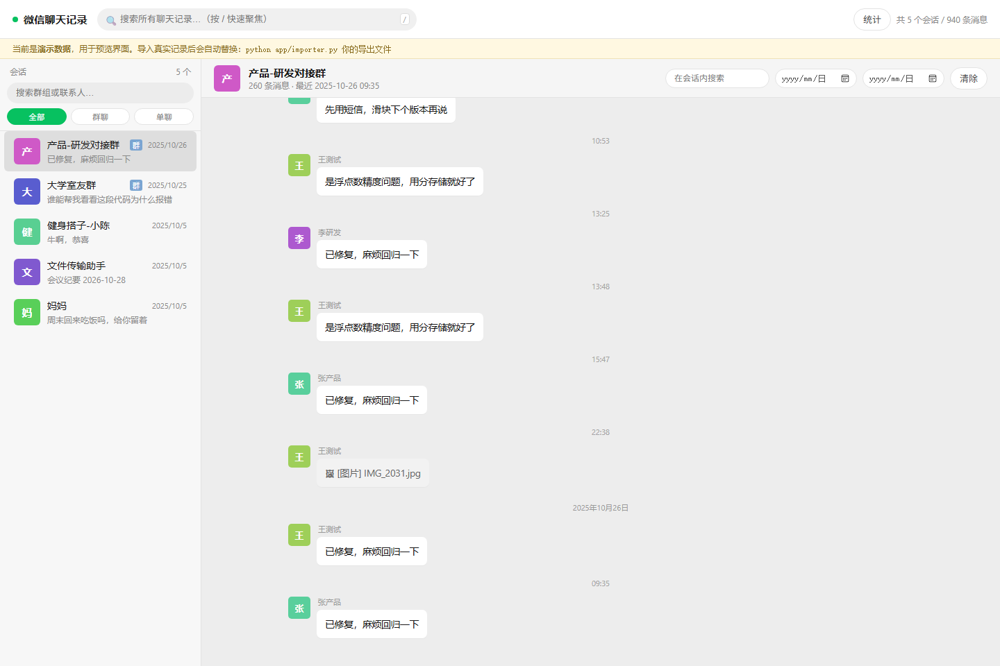
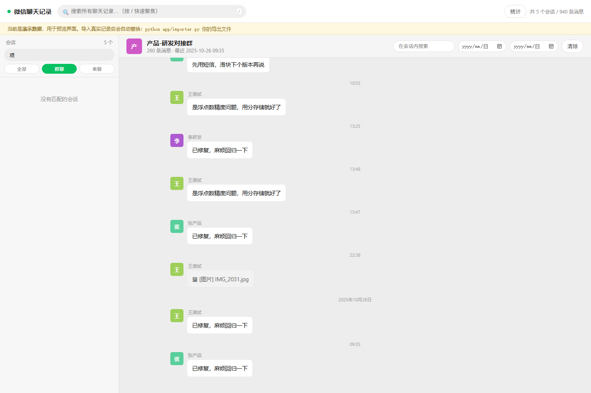
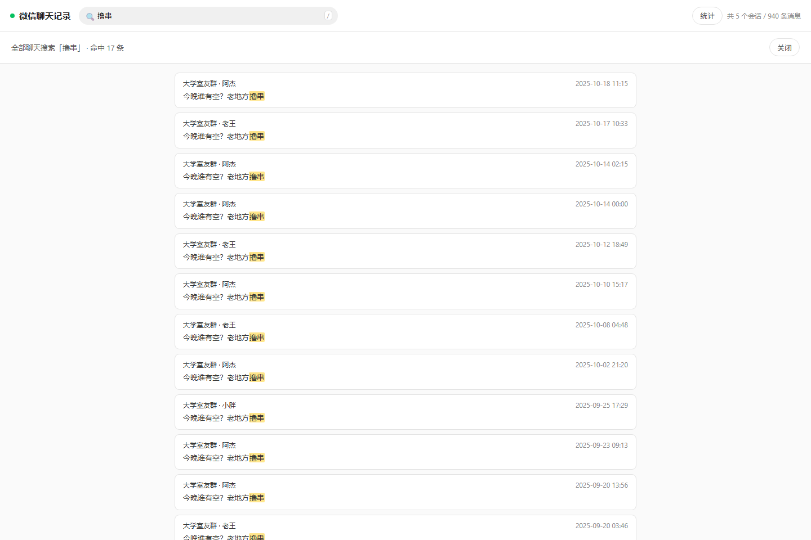

<div align="center">

# 微信聊天记录 · 本地导出与查看器

把 Windows 微信（含 **4.1 新版**）的聊天记录解密导出，落成一个可以全文检索的本地网页，
支持按群组 / 联系人快速定位会话。

纯本地运行 · 不联网 · 不上传任何数据



</div>

---

## 这是什么

一个「自用备份」工具链，解决三件事：

1. **解密**：微信 4.x 的聊天数据库是 SQLCipher 加密的，密钥只在已登录进程内存中；
2. **导出**：把 25 个数据库（含 WAL 里的最新消息）解析成会话 + 消息，写入本地归档库；
3. **查看**：一个零依赖的本地网页，按会话浏览、全库搜索、日期筛选、统计。

不是微信客户端替代品，也不做任何自动化操作（不发消息、不扫码、不登录）。

## 功能

| 能力 | 说明 |
|---|---|
| 会话搜索 | 左栏输入即过滤，支持「全部 / 群聊 / 单聊」切换，命中关键字高亮 |
| 全库搜索 | 一次搜索所有会话，点结果直接跳到原消息并高亮 |
| 会话内搜索 | 单个聊天内部再检索 |
| 日期筛选 | 指定起止日期，只看某段时间 |
| 消息气泡 | 自己发的在右侧，群聊显示发言人昵称与头像色块；连续发言合并头像 |
| 统计 | 年度消息分布 + 发言人条数排行 |
| 增量重导 | 双击 `更新数据.bat` 全量重建（需微信已登录） |
| 多格式导入 | 也支持第三方工具导出的 CSV / JSON（`app/importer.py`） |

<table>
<tr>
<td></td>
<td></td>
</tr>
<tr>
<td align="center">按群聊/单聊筛选 + 关键字高亮</td>
<td align="center">全库搜索，命中 17 条</td>
</tr>
</table>

## 支持版本

| 微信版本 | 数据目录 | 密钥形态 | 支持 |
|---|---|---|---|
| 4.1.x | `xwechat_files\<account>\db_storage` | XOR 混淆在 WCDB `Config.Cipher` 对象中 | ✅ 主力支持（已在 4.1.11 实测） |
| 4.0.x | 同上 | 内存明文 `x'<64hex>'` | ✅ 通常可直接用 |
| 3.x | `Documents\WeChat Files\<wxid>` | 内存 32 字节 hex | ⚠️ 需改密钥提取方式 |

实测规模：471 个会话 / 145.6 万条消息 / 归档库约 1.3 GB / 全量导出约 15 分钟。

## 工作原理

```
微信进程(已登录) ──① 提取密钥──> keys.json
      │                              │
      └──② SQLCipher 解密 db_storage ┘
                     │
            ③ 解析 Msg_* 表 → 还原会话名/发送者/是否本人
                     │
            ④ 写入 data/archive.db（SQLite + 索引）
                     │
            ⑤ app/server.py 提供 HTTP API + 静态页面（127.0.0.1）
```

关键实现细节（也是这个项目存在的原因）：

- 微信 4.1 **不再**把明文密钥留在内存里，需要从 WCDB 的 `com.Tencent.WCDB.Config.Cipher`
  配置对象按混淆规则还原，再用 HMAC + 库文件头盐值校验；
- 这层逻辑用 PyPI 上的 [`wechatauto-replica`](https://pypi.org/project/wechatauto-replica/)
  的 `db` 模块完成，但必须**绕过它的 `__init__.py`**（会 import uiautomation / winsdk 等重依赖）；
- 消息归属按 `real_sender_id → wxid` 还原，「是不是我发的」用 **wxid 比对**，不能用昵称猜（重名会错）。

更完整的复现笔记见 [`wechat-chat-export/SKILL.md`](wechat-chat-export/SKILL.md)。

## 快速开始

### 1. 环境

- Windows 10/11
- Python 3.10+
- 微信 PC 版已安装，**并且已经登录**（密钥只存在于已登录进程内存里）

### 2. 安装依赖

```bash
git clone <你的仓库地址>
cd <仓库目录>

python -m venv .venv
.venv/Scripts/python.exe -m pip install --upgrade pip

# 关键：--no-deps 安装，避免拖入 GUI 自动化相关的重依赖
.venv/Scripts/python.exe -m pip download --no-deps -d _tools/pkg wechatauto-replica
.venv/Scripts/python.exe -m pip install --no-deps _tools/pkg/wechatauto_replica-*.whl
.venv/Scripts/python.exe -m pip install cryptography zstandard pywin32 colorama
```

> `_tools/pkg` 是本地临时目录，已在 `.gitignore` 中。

### 3. 配置

```bash
copy config.example.py config.py
```

编辑 `config.py`：

```python
DB_DIR  = r"D:\xwechat_files"        # 账号目录的【上一级】
ACCOUNT = "your_account_abcd"        # 账号目录名，如 xxxx_0dfa
```

账号目录名可以这样查：

```powershell
Get-ChildItem "$env:USERPROFILE\Documents\xwechat_files" -Directory
# 或 D:\xwechat_files、其它自定义路径
```

`config.py` 含个人路径信息，**已被 gitignore，不会提交**。

### 4. 提取密钥并导出

```bash
# 先验证能拿到密钥（应输出 "共 25 个库的密钥"）
.venv/Scripts/python.exe scripts/extract_keys.py

# 全量导出（约 15 分钟，1.3 GB 数据）
.venv/Scripts/python.exe scripts/export_to_archive.py
```

也可以双击 `更新数据.bat`（Windows 一键）。

### 5. 启动查看器

```bash
python app/server.py
# 或双击 启动.bat
```

自动打开 <http://127.0.0.1:8777/>（端口被占用会自动顺延到 8778~8784）。

## 使用技巧

| 操作 | 说明 |
|---|---|
| `/` | 聚焦全库搜索 |
| `Ctrl+K` 或 `F` | 聚焦会话搜索（找群/找人） |
| `Esc` | 清空搜索 / 关闭浮层 |
| 上滑到顶 | 自动加载更早消息 |
| `?q=关键词` | URL 直达搜索结果 |
| `?chat=张&kind=single` | URL 直达会话搜索（`kind` 取 `group` / `single`） |
| `?stats=1` | 直接打开统计 |

## 想先看看界面？

没有微信数据也能跑：生成一份演示数据。

```bash
python app/demo_data.py     # 5 个会话 / 940 条消息
python app/server.py
```

## 目录结构

```
.
├── app/
│   ├── server.py            HTTP 服务（纯标准库，无第三方依赖）
│   ├── db.py                归档库 schema 与读写
│   ├── importer.py          通用导入器（CSV / JSON）
│   ├── demo_data.py         演示数据生成
│   └── static/              前端（原生 JS，无构建步骤）
├── scripts/
│   ├── extract_keys.py      提取 25 个库的密钥
│   ├── load_wdb.py          加载 db 模块的示例骨架
│   └── export_to_archive.py 全量导出到 data/archive.db
├── wechat-chat-export/      完整流程笔记（可作 WorkBuddy skill 安装）
├── docs/                    截图
├── config.example.py        配置模板
├── 启动.bat / 更新数据.bat / 导入数据.bat
└── data/                    归档库（gitignore，你自己的聊天记录）
```

## 常见问题

**Q：密钥数 0 / 拿不到密钥？**
微信必须**已登录**且已打开过数据库。登录后等 30 秒，观察
`<db_dir>\<account>\db_storage\contact\contact.db-wal` 的修改时间是否在更新。

**Q：`import wechatauto` 报 uiautomation / winsdk 错误？**
说明走了包的 `__init__.py`。用 `scripts/extract_keys.py` 里的 `load_db_module()`，按文件路径加载 `db.py`。

**Q：导出后看到 `<msg>` 这种乱码？**
原始 XML 消息未转换。`scripts/export_to_archive.py` 已把非文本消息转成 `[图片]` 等占位；历史数据可重跑一次导出。

**Q：图片/语音/视频能看吗？**
目前**不能**。附件是独立的 `.dat` 加密文件（另一套密钥），社区暂无可靠公开方案，界面以占位符显示「谁在什么时候发了什么类型的消息」。

**Q：能导入第三方工具导出的记录吗？**
可以。`python app/importer.py <文件或目录>`，自动识别中英文列名（时间/发送者/内容/群聊…），支持 `{"messages":[...]}` 与 `{"chats":[{...,"messages":[...]}]}` 两种 JSON 结构，重复导入自动去重。

## 隐私与安全

这个工具处理的是**你全部的私人聊天记录**，请务必注意：

- 🔒 **不要提交 `data/`、`config.py`、`_tools/wdb_work/`**。`.gitignore` 已排除，但 `git add -f` 之类的操作要避免；
- 🔑 `_tools/wdb_work/keys.json` 里的密钥**等于你全部聊天记录的钥匙**，泄露即可被完整解密；
- 🌐 查看器只监听 `127.0.0.1`，不对外网开放；若改绑 `0.0.0.0` 请自行加鉴权；
- 📷 若要截图分享，请用演示数据（`python app/demo_data.py`），不要截真实会话；
- 🧹 全程对微信原始数据**只读**，不修改、不移动、不覆盖。

## 免责声明

- 本项目仅供**个人备份与检索自己的聊天记录**使用；
- 不提供、不支持任何获取他人数据的能力；请勿用于侵犯他人隐私；
- 依赖的第三方库（`wechatauto-replica` 等）由各自作者维护，本项目不保证其长期可用；
- 解密本地数据库可能违反微信用户协议，存在账号风险；同类开源项目曾因 DMCA 下架，
  是否使用、是否公开分发请自行判断并承担后果。

## 致谢

- [`wechatauto-replica`](https://pypi.org/project/wechatauto-replica/) —— 4.0/4.1 密钥提取与数据库读取
- [SQLCipher](https://www.zetetic.net/sqlcipher/) —— 数据库加密方案
- 前端零依赖手写，未使用任何框架

## License

[MIT](LICENSE)
